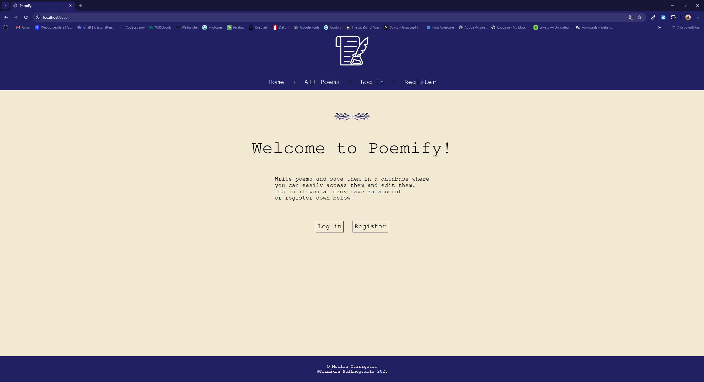

# Case 6 PHP - Crud App "Poemify"

Välkommen till Poemify. En Crud applikation där du kan skapa ett konto och spara dina dikter.

För att komma igång så behöver du följa stegen nedan:

### Steg 1
Installera och starta Docker Desktop.

https://www.docker.com/

### Steg 2
Klona ner repot

### Steg 3
Öppna terminalen och ange kommandot: `docker-compose up`

### Steg 4
När applikationen startat (tar ngn minut första gången) öppna en webbläsare och navigera till 
http://localhost:8060

I webbläsaren bör du nu se Poemify's startsida.

### Steg 5

För att installera tabellerna:
Skriv "localhost:8060/_setup.php" i sökrutan.

Efter detta bör det stå "localhost:8060/?install=true".
Då är du redo att sätta igång!

#### Skapa ett konto, logga in och sätt igång och skriv dina dikter!

### Såhär ser appen ut i drift

#### Länk till figma-skiss: https://www.figma.com/design/1zKrU9EnszJyowgWXyjmjA/Case-5?node-id=420-2&t=9ZcO8EDxnegmMZ5v-1